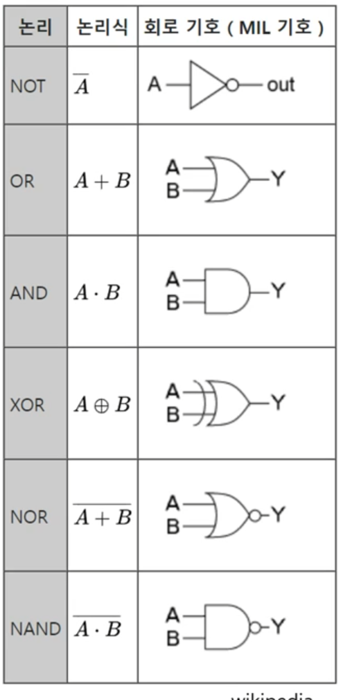
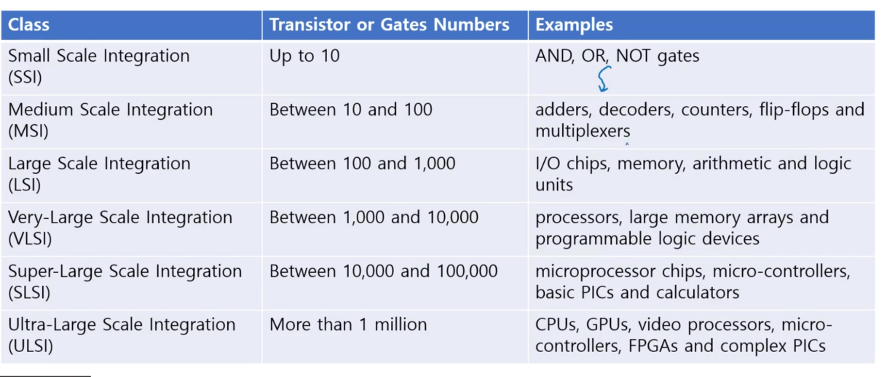
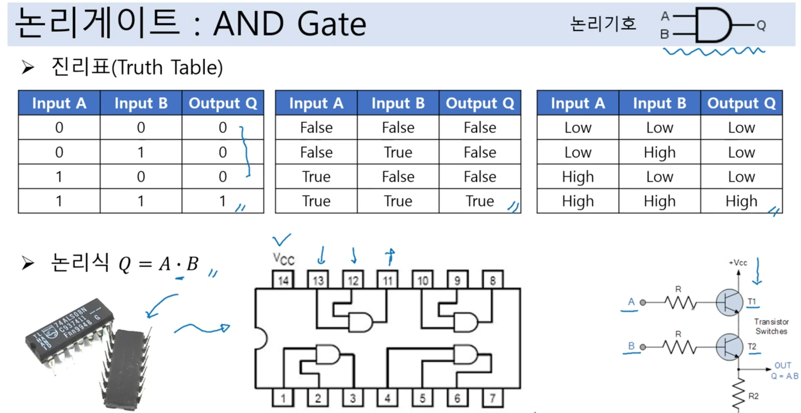
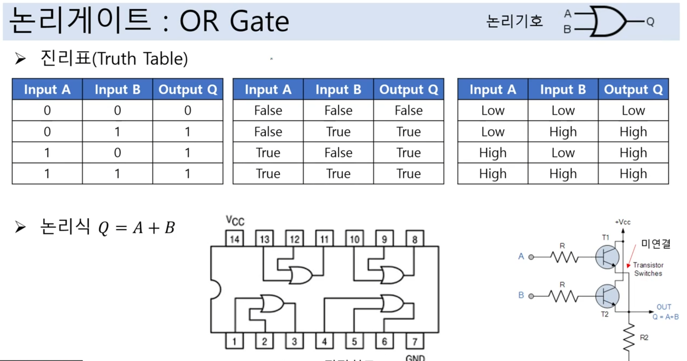
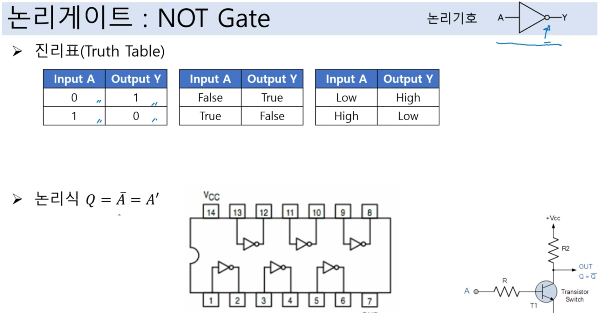
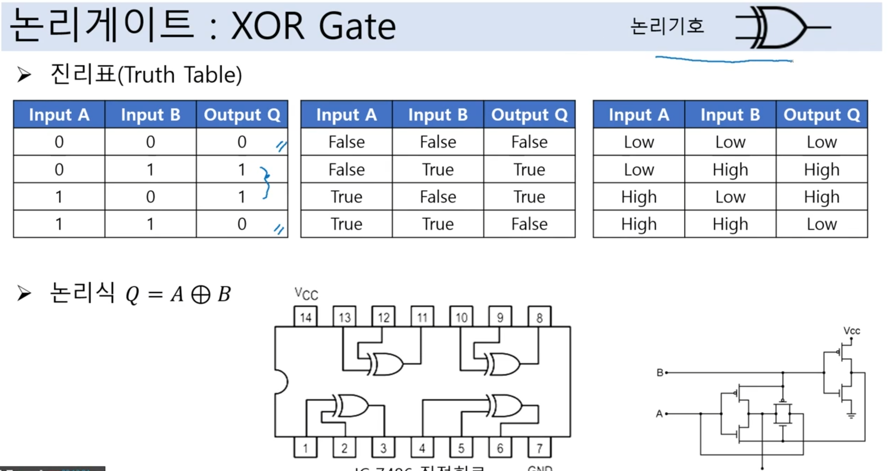
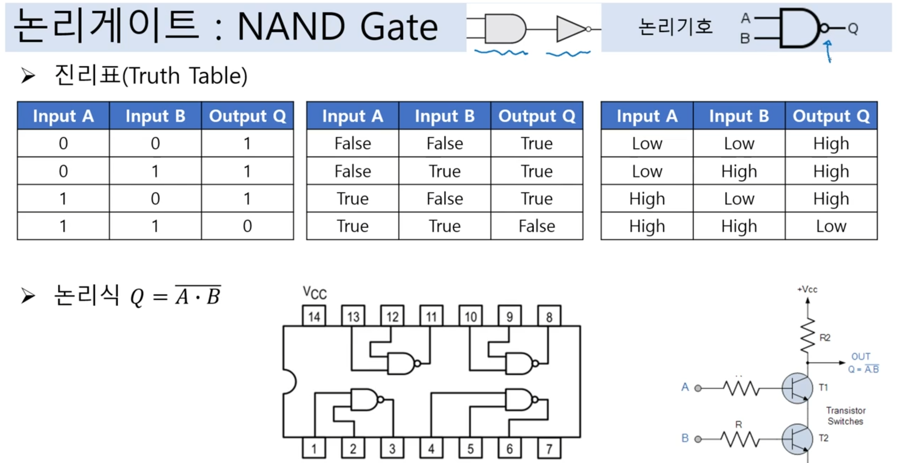
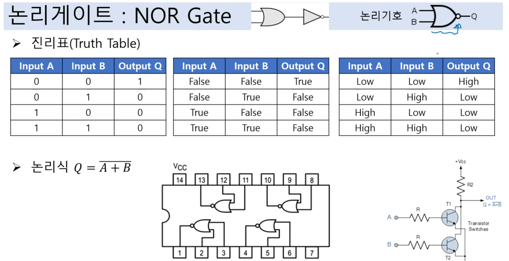
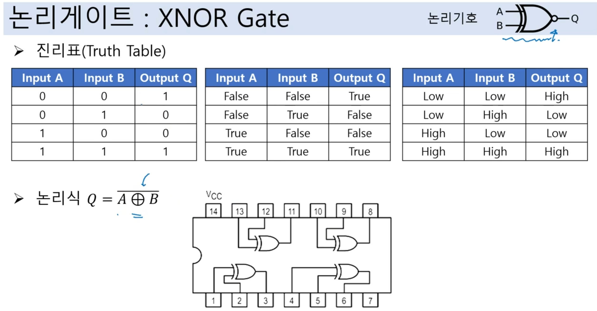

# 논리게이트

## 논리게이트
- 디지털 회로에서 기본적인 구성요소
- 논리 연산을 수행하는 역할
- 이진 논리 -> 0,1,참,거짓

1. AND 게이트: 모든 입력이 참일 때만 출력이 참
2. OR 게이트: 하나 이상의 입력이 참일 때 출력이 참
3. NOT 게이트(또는 인버터): 단일 입력의 논리 상태를 반전, 즉 입력이 참이면 출력은 거짓, 입력이 거짓이면 출력은 참
4. NAND 게이트: AND 게이트의 출력을 반전시킨 것으로, 모든 입력이 참이 아닐 때 출력이 참
5. NOR 게이트: OR 게이트의 출력을 반전시킨 것으로, 모든 입력이 거짓일 때만 출력이 참
6. XOR 게이트(배타적 OR 게이트): 입력이 서로 다를 때만 출력이 참
7. XNOR 게이트(배타적 NOR 게이트 또는 동등성 게이트): 입력이 서로 같을 때 출력이 참

- 산술 논리 연산 장치(ALU), 메모리, 레지스터, 디코더, 멀티플렉서 등의 중요한 디지털 회로를 만들 수 있음

 

## Transistor
- 반도제 장치로서, 전류를 제어하는 역할
- 신호 증폭, 스위치처럼 작동하는 다양한 용도

 

## 집적회로(Integrated Circuit)
- 작은 실리콘 칩 위에 수천, 수백만 트랜지스터, 다이오드, 레지스터, 캐패시터 등의 전자 부품이 집적되어 있는 회로
1. 디지털 IC
2. 아날로그 IC
3. 혼합 신호 IC

### 집적회로 분류

 

## AND Gate

 

## OR Gate

 

## NOT Gate

 

## XOR Gate

 

## NAND Gate

 

## NOR Gate

 

## XNOR Gate

 

## 범용 논리 게이트
- 단일 게이트 형태로 모든 종류의 논리 연산을 수행할 수 있는 게이트
- NAND 게이트, NOR 게이트