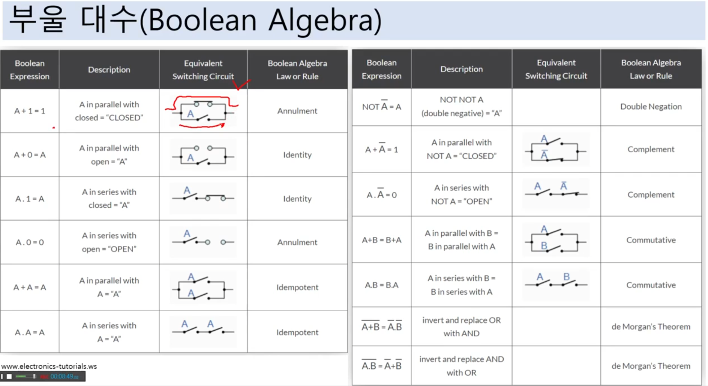

# 부울 대수
## 부울 대수
- 논리적인 명제 및 연산을 수학적으로 다루는 방법을 제공
1. 변수: 부울 대수에서 변수는 오직 두 가지 값, 즉 참(True) 또는 거짓(False)만을 가질 수 있음
2. 연산자: 부울 대수의 기본 연산자는 AND, OR, NOT 이들은 각각 논리곱, 논리합, 논리부정을 나타냄
  - AND 연산: 두 입력이 모두 참일 때만 결과가 참
  - OR 연산: 두 입력 중 하나라도 참이면 결과가 참
  - NOT 연산: 입력의 논리 값을 반전
3. 교환 법칙, 결합 법칙, 분배 버칙, 드 모르간의 법칙 등
- 논리 회로를 설계할 때에 부울 대수를 이용하면 논리 회로를 정확하고 간결하게 표현 가능
  - 비용, 속도, 크기, 신뢰성 등의 장점

  